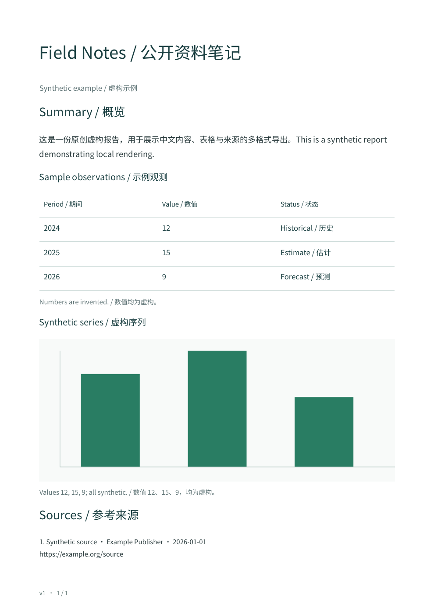

# Report Export Kit · 结构化报告导出工具

[English](README.md) · [简体中文](README.zh-CN.md)

[](https://github.com/workstonedai-collab/report-export-kit/actions/workflows/ci.yml) · [MIT](LICENSE) · Node.js 22.12+

**将同一份结构化内容，在本地导出为可阅读的 PDF、可编辑的 Word 和便于流转的 Markdown。**

当研究脚本或 Agent 已经生成正文、表格和图表，Report Export Kit 负责把它们交付成文件：按小型 JSON 协议组织内容，保留参考来源，再导出三种格式，过程中不重新写作。适用于研究笔记、运营简报及需要离开聊天窗口的 Agent 报告。

无需模型、账户或密钥。渲染器不会读取来源网址，也不会把报告内容发送到服务端。



## 新增示例

新增 `exportRecordWorkbook(records)`：将传入的固定版本快照导出为 XLSX，含
Records、Fields、Manifest 三张表。每条需要 `id`、`version` 和 JSON `fields`
对象，可选 `source` 来源文字。运行 `node examples/records.js` 体验虚构长文。
用户单元格始终按文本写入，包括 `=` 开头的内容；长字段按顺序分片，保留 JSON
Pointer 路径，以记录 ID、版本、路径和数字 Part 拼回全文。不联网，也不替换成
最新记录。上限为 1000 条、50000 个字段分片、10 MB 输入；不支持的 XML 字符
明确拒绝。文件会包含你提供的资料，需自行保护。此记录导出接口独立于下方三种报告格式。

## 阅读导航

- [适合哪些交付场景](#适合哪些交付场景)
- [先运行完整示例](#先运行完整示例)
- [输入协议](#输入协议)
- [命令行](#命令行)
- [从现成 JSON 开始做自己的报告](#从现成-json-开始做自己的报告)
- [常见问题](#常见问题)
- [首版能力](#首版能力)
- [使用边界](#使用边界)
- [开发与验证](#开发与验证)

## 适合哪些交付场景

| 场景 | 你提供什么 | 可以交付什么 |
| --- | --- | --- |
| 研究简报 | 已核对正文、观测表格和参考来源 | 可阅读 PDF 与可编辑 Word |
| 周报或运营记录 | 脚本生成的固定 JSON 内容 | 同一内容的三种格式 |
| Agent 报告交付 | 映射到规范内容块的 Agent 输出 | 带来源列表与版本的下载文件 |

导出器使用你提供的内容，不会调用模型改写段落、编造图表解读或联网取证。可以把渲染交付与研究写作分别检查，也便于重复生成。

## 先运行完整示例

需要 **Node.js 22.12+**，在项目目录运行：

```sh
git clone https://github.com/workstonedai-collab/report-export-kit.git
cd report-export-kit
npm ci
npm run demo
```

打开 `output/demo.pdf`、`output/demo.docx` 和 `output/demo.md`。示例包含中英文正文、表格、本地生成的 PNG 图表和示例来源，**所有数值与结论均为虚构**。Markdown 的图片保存在同目录的 `figure-1.png`。

项目包含未经修改的 Noto Sans CJK SC 字体与 OFL 许可，供中文 PDF 使用。若字体缺失，运行 `npm run setup-font` 从 Noto 官方仓库取回，也可以通过 `fontPath` 提供自己的兼容字体。

## 输入协议

```js
import { exportReport } from './src/index.js';
import fs from 'node:fs/promises';

const report = {
  title: 'Weekly notes / 每周笔记', version: 1,
  blocks: [
    { type: 'heading', text: 'Findings / 发现' },
    { type: 'paragraph', text: '自己已经核对的内容。' },
    { type: 'table', headers: ['期间', '数值'], rows: [['2025', 12]] },
  ],
  sources: [{ title: '资料来源', url: 'https://example.org/data' }],
};
const file = await exportReport(report, 'pdf');
await fs.writeFile('report.pdf', file.content);
```

| 内容块 | 必填 | 说明 |
| --- | --- | --- |
| `heading` | `text` | 可选层级 1–3 |
| `paragraph` | `text` | 纯文本，可含换行 |
| `table` | `headers`、`rows` | 每行列数应匹配表头，可加标题和注释 |
| `image` | PNG base64 `data` | 可加标题与图注，尺寸从 PNG 读取 |

顶层包含 `title`、可选正整数 `version`、`subtitle`、`blocks` 和 `sources`。来源须提供标题与 HTTP(S) 链接，可附机构与日期。这是报告参考列表，渲染器不会自动建立每条结论的证据对应，也不会核验来源。

导出 Markdown 后，需要将返回的 `assets` 图片写到 `.md` 同目录。结果还包括字节数、版本及文件 SHA-256。哈希标识该次文件；PDF 元数据可能使两次独立生成的文件哈希不同。

## 命令行

```sh
node src/cli.js your-report.json output
```

生成 `report.pdf`、`report.docx`、`report.md` 和 Markdown 图片。可用第三个参数指定字体路径。输出采用固定文件名，重复运行会覆盖对应文件。

## 从现成 JSON 开始做自己的报告

项目提供可编辑的小型输入文件 `examples/report.json`，直接运行：

```sh
npm run export -- examples/report.json output/my-report
```

复制该文件，修改标题、段落、表格和来源，再把命令中的输入路径换成自己的文件。生成 `report.pdf`、`report.docx`、`report.md`；有图片时还会生成 Markdown 的配套 PNG。分享 Markdown 时要把图片放在同目录并一起发送。

作为库调用时，明确写出三个文件及配套图片：

```js
import fs from 'node:fs/promises';
import path from 'node:path';
import { exportReport } from './src/index.js';

const report = JSON.parse(await fs.readFile('examples/report.json', 'utf8'));
const directory = 'output/my-report';
await fs.mkdir(directory, { recursive: true });
for (const format of ['pdf', 'docx', 'md']) {
  const result = await exportReport(report, format);
  await fs.writeFile(path.join(directory, `report.${format}`), result.content);
  for (const asset of result.assets) {
    await fs.writeFile(path.join(directory, asset.filename), asset.content);
  }
  console.log(format, result.bytes, result.version, result.sha256);
}
```

需要保留历史时，每份报告使用独立输出目录。`version` 标记输入内容的版本；工具不会维护修订数据库。

### 加入图表或更换字体

已有 PNG 图表时，把图片字节转为 base64，作为 `image` 内容块加入：

```js
const data = (await fs.readFile('your-chart.png')).toString('base64');
report.blocks.push({ type: 'image', data,
  title: '我的图表', note: '在此写明单位、准确数值和来源。' });
```

内置 `barChart` 小工具可以本地绘制非负数值的柱状图。准确标签、单位和数值写在表格或图注里。该小工具不支持负值、交互图或远程图片；复杂图表可用自己习惯的绘图工具生成 PNG 后导入。

更换 PDF 字体可传入 `exportReport(report, 'pdf', { fontPath: './your-font.ttf' })`，或使用命令行第三个参数。字体应覆盖正文所需文字并允许相应用途；接收 Word 的电脑需要兼容字体。

## 常见问题

| 现象 | 怎样处理 |
| --- | --- |
| 中文 PDF 出错或缺字 | 检查内置字体是否存在，或提供兼容的 `fontPath`；必要时用 `npm run setup-font` 取回官方字体 |
| 表格校验失败 | 每行列数须匹配表头；单元格使用有限数值或字符串 |
| Markdown 图表打不开 | 将返回的 `assets` 保存到 Markdown 同目录，保持文件名 |
| 来源校验失败 | 提供标题及有效 HTTP(S) 链接 |
| Word 与 PDF 排版不同 | Word 可重排版，检查本机字体和阅读软件的页面设置 |
| 旧输出被覆盖 | 命令行采用固定文件名，不同报告版本应使用不同目录 |

## 首版能力

- 一套输入协议，对应三种交付格式。
- 内置开放字体，支持中英文 PDF。
- Word 中的真实表格与嵌入 PNG 图片。
- PDF 表格跨页重复表头；超大单行内容转为带标签的段落。
- 来源、版本和文件哈希随结果保留。
- `src/charts.js` 提供简单本地 PNG 柱状图；准确数值、标签和单位写在旁边的表格或图注中。

## 使用边界

这是结构化报告渲染器，尚不支持任意 HTML/Markdown 导入、Office 模板编辑或文档解析。图片格式为 PNG；标题和段落使用纯文本。Word 排版会受阅读软件与字体影响，DOCX 引用字体名称，不嵌入字体。PDF 使用 A4 和简洁排版。

输入校验能发现格式错误和不支持的链接协议，不判断事实真伪。导出前应核对内容。文档和图片有大小限制；处理在本地完成，但最终文件仍会包含你输入的内容。

## 开发与验证

```sh
npm test
```

测试覆盖三格式、输入不被改写、表格和来源校验，以及多页双语 PDF。示例 PDF 还经过重新打开、中文/来源文本检查和图片排版检查。CI 配置覆盖 Node 22/24 及三种桌面系统。

字体与依赖说明见 [THIRD-PARTY-NOTICES.md](THIRD-PARTY-NOTICES.md)，贡献方式见 [CONTRIBUTING.md](CONTRIBUTING.md)。项目代码使用 [MIT](LICENSE)。第三方依赖及数据保留自身条款。
